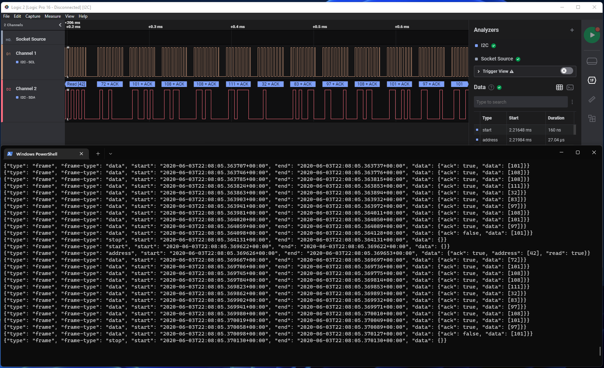
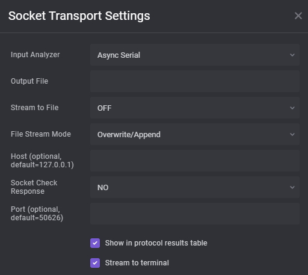
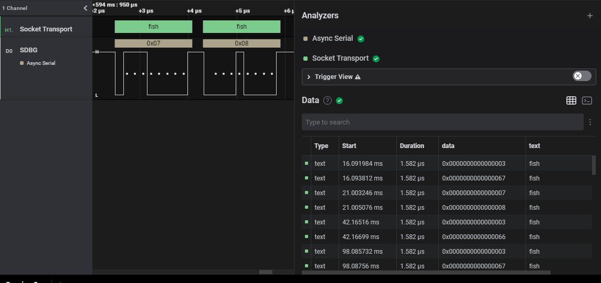

# SaleaeSocketTransportHLA Usage

A High Level Analyzer for Saleae which redirects analyzer frames to a network socket and accepts input on 
the same socket in order to generate AnalyzerFrames. Optionally supports sending data to a file either in-lieu of
a socket or in addition to a socket.



## Analyzer Options

The analyzer supports various user controlled options to allow for custom behavior. These options are 
shown in the screenshot below and can be generally divided into "Socket Controls" and "File Stream Controls".



Some general use cases:
- **You want to stream to a socket only**: Set `Host|Port|Socket Check Response` as required for your client, set `Stream to File = OFF`.
- **You want to stream to a file only**: Set `Stream to File = ON, no socket`, and ensure that `Output File` is a valid path and full file name (with extension), set `File Stream Mode` as desired.
- **You want to stream to a socket and a file**: Follow the same general guidelines as the above options, but set `Stream to File = ON, with socket`.

### Socket Controls

| Option | Description |
| ------ | ----------- |
| Host   | Set the host address to bind the socket to. By default this will use `localhost` loopback on address `127.0.0.1`, but you can change this to a different network address provided that it can be routed to in the clear. |
| Port   | Set the port number to bind the socket to. By default this will use `50626`, but you can use any socket number you wish. A widely compatible set of 'ephemeral ports' would be in the range of `49125-65535`, anything within these bounds should be broadly safe to use. |
| Socket Check Response | Controls whether the analyzer should check for a response from the client. If there is no connection this setting doesn't matter and the analyzer won't check anyways, but **if there is a connection and the client does not respond the analyzer will wait indefintely**. |

### File Stream Controls

| Option | Description |
| ------ | ----------- |
| Stream to File   | Controls whether file streaming should be enabled or not, there are three options. `OFF` disables file streaming, and makes the other File Stream options irrelevant. `ON, with socket` enables streaming to a file and a socket at the same time. `ON, no socket` enables streaming to a file, and will not connect to a socket. |
| Output File   | Full and valid path to a file, including file name and extension. The final name of the output file will depend on the `File Stream Mode` selection. |
| File Stream Mode | Controls how data is saved to the file across multiple runs. `Overwrite/Append` should probably just be called `Append`, it will create the file exactly as named by `Output File`, multiple runs will continue appending data to this same file. `Sequence` will use the provided `Output File` to generate a monotonically increasing set of file names of the format `<fname>-<seq_num><ext>` where `Output File = <fname><ext>`, each analyzer run will create a new file. `Timestamp` will create a file name based on `Output File` of the format `<fname>-<timestamp><ext>` where the timestamp is of format `YYYY-MM-DDTHH-mm-ss`, each analyzer run will create a new file (assuming runs are separated by at least one second). |

## Using socketclient.py

This repository includes a helper utility `socketclient.py` which can be used to connect to the Analyzer
socket, process received data, and generate responses back to the Analyzer. The behavior of this utility
is fully customizable by implementing your own subclass of `responsehandler.ResponseHandler`, there are a few
example implementations in that module to get started with.

You can exit this tool at any time with the `CTRL+C` key combination.

Basic usage instructions can be found with `python socketclient.py --help`:

```
usage: socketsink.py: Read data from a streaming socket and print to STDOUT [-h] [-H HOST] [-P PORT] [-q] [-r RESPONDER] [--quiet-receive] [--quiet-response] [--show-message-dir]

options:
  -h, --help            show this help message and exit
  -H HOST, --host HOST  host address to bind to
  -P PORT, --port PORT  port to bind to
  -q, --quiet           do not print any message responses
  -r RESPONDER, --responder RESPONDER
                        custom responder to process messages from server, provide a full path and class name as <fpath>:<class_name>
  --quiet-receive       do not print the data received from the server
  --quiet-response      do not print the data sent back to the server
  --show-message-dir    when logging responses, show direction of message transmission
```

### Example Response Handler and Usage of Custom Responder

Implementing a response handler is simple (in theory). As an example, this section will walk through the 
steps necessary to implement a response handler that responds to every frame with the word "fish".

First, create a new file named `fishresponder.py` anywhere you like. The untracked `responders` folder
is provided in this repository for this purpose, but anywhere on your system should be fine.

Within that file, implement the following `ResponseHandler`:

```python
from responsehandler import ResponseHandler


class FishResponder(ResponseHandler):
    """A response handler that responds to every frame with the word 'fish'"""
    def handle_incoming_response(self, recv: str):
        decode = self.prepare_json_incoming(recv)

        # if the received data is not a frame, just send it back as we received it
        if decode['type'] != 'frame':
            return self.prepare_json_outgoing(recv)

        decode['frame-type'] = 'text'
        decode['data']['text'] = 'fish'
        return self.prepare_json_outgoing(decode)
  ```

 Now execute `socketclient.py` and tell it where to find your responder using the `-r/--responder` option, 
 if you placed the file in the `responders` folder, your executed command should look something like this:

 ```
 python socketclient.py -r responders/fishresponder.py:FishResponder
 ```

Finally, open up Saleae Logic 2 and attach the Socket Transport analyzer to a low level analyzer of your choice,
capture some data or analyze an existing file and watch as your data is transformed to fish.



## ResponseHandler API Reference

The `ResponseHandler` base class provides a framework for processing data received from the Saleae analyzer and generating appropriate responses. All custom responders should inherit from this class and implement the required methods.

### Base Class: `ResponseHandler`

**Location**: `responsehandler.py`

#### Required Method

Every ResponseHandler subclass must implement:

```python
def handle_incoming_response(self, recv: str) -> bytes:
    """Process incoming data from Saleae and return response bytes

    Args:
        recv: Raw string data received from Saleae (JSON format)

    Returns:
        bytes: Response data to send back to Saleae, or None for no response
    """
```

This method is called once for each message received from the Saleae analyzer. The `recv` parameter contains the raw JSON string data, and the method should return properly formatted bytes to send back, or `None` if no response is needed.

#### Instance Variables

The base class provides several instance variables for maintaining state across multiple frames:

| Variable | Type | Description |
| -------- | ---- | ----------- |
| `tracking_frame` | `Any` | Storage for building frame information across multiple received frames. Set to `None` when frame processing is complete. |
| `previous_data` | `list` | Storage for data from previous frames that may be needed for analysis. Reset to `[]` when consumed. |
| `current_incoming` | `TransportData` | The most recent incoming message after being processed by `prepare_json_incoming()`. Provides access to message in multiple formats (bytes, string, dict). |
| `current_outgoing` | `TransportData` | The most recent outgoing message after being processed by `prepare_json_outgoing()`. Provides access to message in multiple formats. |

#### Helper Methods

The base class provides two essential helper methods for data transformation:

##### `prepare_json_incoming(data: Union[bytes, dict, str]) -> dict`

Prepares incoming data for processing by converting it to a dictionary and storing it in `self.current_incoming`.

```python
def handle_incoming_response(self, recv: str) -> bytes:
    # Convert raw string to dictionary
    decoded = self.prepare_json_incoming(recv)

    # Now work with decoded dictionary
    if decoded['type'] == 'frame':
        # Process frame...
        pass
```

**Parameters:**
- `data`: The incoming data in any format (bytes, dict, or str)

**Returns:**
- `dict`: The data as a JSON dictionary

##### `prepare_json_outgoing(data: Union[bytes, dict, str]) -> bytes`

Prepares outgoing data for transmission by converting it to properly formatted bytes with newline termination.

```python
def handle_incoming_response(self, recv: str) -> bytes:
    decoded = self.prepare_json_incoming(recv)

    # Modify the data
    decoded['data']['text'] = 'Modified!'

    # Convert back to bytes for transmission
    return self.prepare_json_outgoing(decoded)
```

**Parameters:**
- `data`: The outgoing data in any format (bytes, dict, or str)

**Returns:**
- `bytes`: Properly formatted bytes with newline, ready for socket transmission

### Built-in ResponseHandler Implementations

The library includes several pre-built responders for common use cases:

#### `DefaultResponder`

**Location**: `responsehandler.py:82-143`

An intelligent responder that automatically detects the analyzer type (Async Serial, I2C, SPI) and formats data appropriately.

**Features:**
- Auto-detection of analyzer type based on frame structure
- Async Serial: Formats byte data as hex strings (e.g., "0x42")
- I2C, SPI: Passes through data unchanged
- Handles non-frame messages gracefully

**Usage:**
```bash
python socketclient.py  # Uses DefaultResponder by default
```

**When to use**: General purpose data visualization, quick protocol analysis, when you don't need custom processing.

#### `NullResponder`

**Location**: `responsehandler.py:146-149`

A responder that receives data but never sends responses back to Saleae.

**Usage:**
```python
from responsehandler import NullResponder

class MyConsumer(NullResponder):
    def handle_incoming_response(self, recv: str) -> bytes:
        decoded = self.prepare_json_incoming(recv)
        # Log to file, database, etc.
        self.log_to_file(decoded)
        return None  # Never respond to Saleae
```

**When to use**: Data logging, one-way monitoring, when you don't want to generate frames in Saleae.

#### `AckResponder`

**Location**: `responsehandler.py:152-155`

A responder that acknowledges every message with a simple ACK response.

**Usage:**
```python
from responsehandler import AckResponder
# Use directly or extend for testing
```

**When to use**: Testing socket connectivity, debugging communication issues, placeholder during development.

### TransportData Helper Class

**Location**: `responsehandler.py:7-46`

A dataclass that provides convenient format conversions for socket data.

**Attributes:**
- `as_bytes`: The data as UTF-8 encoded bytes
- `as_dict`: The data as a JSON dictionary
- `as_str`: The data as a JSON string

**Factory Methods:**
- `TransportData.from_bytes(data: bytes)`
- `TransportData.from_dict(data: dict)`
- `TransportData.from_str(data: str)`
- `TransportData.from_any(data: Union[bytes, dict, str])`

This class is used internally by `prepare_json_incoming()` and `prepare_json_outgoing()` but can also be used directly in custom responders.

### Best Practices for Custom Responders

1. **Always check message type first**: Not all messages are frames
   ```python
   decoded = self.prepare_json_incoming(recv)
   if decoded['type'] != 'frame':
       return self.prepare_json_outgoing(decoded)
   ```

2. **Preserve timing information**: Reuse `start` and `end` timestamps from incoming frames
   ```python
   response = {
       'type': 'frame',
       'frame-type': 'text',
       'start': decoded['start'],  # Preserve original timing
       'end': decoded['end'],
       'data': {'text': 'processed'}
   }
   ```

3. **Handle errors gracefully**: Wrap processing in try/except to avoid crashing the client
   ```python
   def handle_incoming_response(self, recv: str) -> bytes:
       try:
           decoded = self.prepare_json_incoming(recv)
           # Process...
       except (KeyError, ValueError) as e:
           print(f"Error processing frame: {e}")
           return self.prepare_json_outgoing(recv)  # Echo on error
   ```

4. **Use instance variables for stateful processing**: Store data across frames
   ```python
   def __init__(self):
       super().__init__()
       self.packet_count = 0
       self.checksums = []
   ```

5. **Return None when no response needed**: Prevents unnecessary socket traffic
   ```python
   if decoded['type'] == 'client-notification':
       print(decoded['data'])
       return None  # Don't respond to notifications
   ```

## Using `socketserver` and `socketclient` Over the Network

While this HLA was designed primarily with the intent of routing data from within Saleae to another
data consumer on the same machine (using localhost loopback), the decision to use sockets as the underlying 
transport means we get the ability to send Saleae data to a remote machine for free. This is not really an
intended use case and may not be robust, so YMMV.

## Socket Data Transport Format

This section details the transport formats for data going out of Saleae as well as what is expected to come back from the client. In both directions the data is transported as JSON encoded to a string with a newline character appended and then all encoded to bytes as UTF-8 data. The remainder of this section will describe the data structure using JSON notation and conventions.

### Data from socketserver to socketclient (Out of Saleae)

All data transmitted from socketserver is guaranteed to include at least one top level key `type` which contains string data indicating the type of the message being sent. There are three types of messages supported, detailed below.

#### `type=frame`

`frame` message types are the core message for data analysis. These message types are intended to be direct JSON compatible representations of the information available in each `AnalyzerFrame` as the HLA executes `decode`. See `AnalyzerFrame` in the [Saleae HLA API Documentation](https://support.saleae.com/extensions/api-documentation).

Each low-level analyzer has its own way of structuring data and it would be impossible to provide a comprehensive list here, so I will only detail the common keys and give a few examples.

Here is the schema for a `frame` message:

```json
{
  "type": "frame",
  "frame-type": "string",
  "start": "string",
  "end": "string",
  "data": "object"
}
```

| Key | Values Description |
| --- | ------------------ |
| type | String. Always `"frame"`. |
| frame-type | String. String content is analyzer dependent. |
| start | String. A string representation of the `SaleaeTime` object available on each `AnalyzerFrame`. This represents the start time of the frame data in the format of `YYYY-MM-DDTHH:mm:(s with decimal)Z`. This is a nanosecond precision timestamp. |
| end | String. The same thing as `start` but denotes the end of the frame instead. |
| data | Object. This will always be a JSON object type, though the contents of the object are entirely up to the low-level analyzer we are attached to. |

Between different low-level analyzers you can expect variation in `frame-type` and `data` and these differences can be used to act on the data in various ways. Saleae provides no direct way to know which low-level analyzer the HLA is connected to, so unfortunately there is not a more direct method to resolve this.

As the structure of `frame` messages can vary so widely depending on the low-level analyzer, it is not feasible to detail all of them here. Instead I will provide some examples, and if your use case falls outside of these examples then it would be best to use `socketclient.py` to print the messages being received from Saleae for the analyzer of your choice in order to understand the data structure.

The Saleae documentation for HLA AnalyzerFrame formats is a comprehensive guide to the types of data you can expect to receive from the built-in Analyzers. You can find [this documetation on the Saleae website](https://support.saleae.com/extensions/analyzer-frame-types).

[Async Serial decoder data](https://support.saleae.com/extensions/analyzer-frame-types/serial-analyzer) is one of the simplest analyzer formats, here is an example frame:

```json
{
  "type": "frame",
  "frame-type": "data",
  "start": "2022-04-30T04:53:34.454575584000Z",
  "end": "2022-04-30T04:53:34.454577166000Z",
  "data": {
    "data": [3]
  }
}
```

[I2C decoder data](https://support.saleae.com/extensions/analyzer-frame-types/i2c-analyzer) is more complex, offering several different frame-types and data structures, here are a few frames from a single transaction:

```json
{"type": "frame", "frame-type": "start", "start": "2020-06-03T22:08:05.369622480000Z", "end": "2020-06-03T22:08:05.369622640000Z", "data": {}}
{"type": "frame", "frame-type": "address", "start": "2020-06-03T22:08:05.369625840000Z", "end": "2020-06-03T22:08:05.369652880000Z", "data": {"ack": true, "address": [42], "read": true}}
{"type": "frame", "frame-type": "data", "start": "2020-06-03T22:08:05.369666800000Z", "end": "2020-06-03T22:08:05.369697360000Z", "data": {"ack": true, "data": [72]}}
{"type": "frame", "frame-type": "data", "start": "2020-06-03T22:08:05.369706320000Z", "end": "2020-06-03T22:08:05.369736400000Z", "data": {"ack": true, "data": [101]}}
{"type": "frame", "frame-type": "data", "start": "2020-06-03T22:08:05.369745360000Z", "end": "2020-06-03T22:08:05.369775280000Z", "data": {"ack": true, "data": [108]}}
{"type": "frame", "frame-type": "data", "start": "2020-06-03T22:08:05.369784400000Z", "end": "2020-06-03T22:08:05.369814320000Z", "data": {"ack": true, "data": [108]}}
{"type": "frame", "frame-type": "data", "start": "2020-06-03T22:08:05.369823440000Z", "end": "2020-06-03T22:08:05.369852880000Z", "data": {"ack": true, "data": [111]}}
{"type": "frame", "frame-type": "data", "start": "2020-06-03T22:08:05.369861840000Z", "end": "2020-06-03T22:08:05.369892880000Z", "data": {"ack": true, "data": [32]}}
{"type": "frame", "frame-type": "data", "start": "2020-06-03T22:08:05.369901840000Z", "end": "2020-06-03T22:08:05.369931760000Z", "data": {"ack": true, "data": [83]}}
{"type": "frame", "frame-type": "data", "start": "2020-06-03T22:08:05.369940880000Z", "end": "2020-06-03T22:08:05.369971280000Z", "data": {"ack": true, "data": [97]}}
{"type": "frame", "frame-type": "data", "start": "2020-06-03T22:08:05.369980240000Z", "end": "2020-06-03T22:08:05.370010160000Z", "data": {"ack": true, "data": [108]}}
{"type": "frame", "frame-type": "data", "start": "2020-06-03T22:08:05.370019280000Z", "end": "2020-06-03T22:08:05.370049200000Z", "data": {"ack": true, "data": [101]}}
{"type": "frame", "frame-type": "data", "start": "2020-06-03T22:08:05.370058320000Z", "end": "2020-06-03T22:08:05.370088560000Z", "data": {"ack": true, "data": [97]}}
{"type": "frame", "frame-type": "data", "start": "2020-06-03T22:08:05.370097680000Z", "end": "2020-06-03T22:08:05.370127280000Z", "data": {"ack": false, "data": [101]}}
{"type": "frame", "frame-type": "stop", "start": "2020-06-03T22:08:05.370130160000Z", "end": "2020-06-03T22:08:05.370130320000Z", "data": {}}
```

#### `type=client-notification`

`client-notification` message types are messages sent from the Saleae analyzer that are intended to be displayed to the end user of the client. 

| Key | Values Description |
| --- | ------------------ |
| type | String. Always `"client-notification"`. |
| data | String. Contains message to be displayed to client user. |
| level | String. One of `["warning", "info", "debug"]` listed in decreasing order of importance. Generally all `warning` messages should be communicated to the user, `info` messages are generally useful but not critical, and `debug` messages can safely be ignored. |

An example of a `client-notification` message follows:

```json
{
  "type": "client-notification",
  "data": "Connected to socket",
  "level": "info"
}
```

#### `type=client-control`

`client-control` message types are messages sent from the Saleae analyzer to the client with the intent of changing client 
settings or otherwise affecting client behavior. Each type of `client-control` message has a unique structure with the presence
of certain keys being the primary indicator of the control type.

Currently there is only one `client-control` message with the following schema:

```json
{
  "type": "client-control",
  "server-expects-response": "bool"
}
```

This message should be consumed by the client to control whether it responds to server messages or merely consumes them.

### Data from socketclient to socketserver (In to Saleae)

Data sent from the client back to the Saleae analyzer must follow the same basic transport format as outgoing data: JSON encoded to a string with a newline character appended, then encoded to UTF-8 bytes. The analyzer will process this data to potentially generate new AnalyzerFrames that appear in the Saleae Logic 2 interface.

#### Transport Format Requirements

All incoming messages must:
1. Be valid JSON objects
2. Include a top-level `type` key
3. End with a newline character (`\n`)
4. Be encoded as UTF-8 bytes

#### Generating AnalyzerFrames: `type=frame`

To generate an AnalyzerFrame in Saleae, the client must send a message with `type` set to `"frame"`. Any message with a different type value will be received but will not generate a frame (the analyzer will simply ignore it and continue processing).

Here is the schema for generating an AnalyzerFrame:

```json
{
  "type": "frame",
  "frame-type": "string",
  "start": "string",
  "end": "string",
  "data": "object"
}
```

| Key | Description |
| --- | ----------- |
| type | String. Must be `"frame"` to generate an AnalyzerFrame. |
| frame-type | String. Determines the type of frame displayed in Saleae. Common values include `"text"`, `"data"`, `"error"`, etc. The value used here should match one of the frame types defined in the HLA's `result_types` dictionary (see socketserver.py:78-80). Currently only `"text"` is explicitly supported. |
| start | String. Timestamp marking the start of the frame in the format `YYYY-MM-DDTHH:mm:ss.SSSSSSSSSSSZ` (ISO 8601 with nanosecond precision). This must match the format used by Saleae's `SaleaeTime` string representation. |
| end | String. Timestamp marking the end of the frame, same format as `start`. |
| data | Object. A JSON object containing the frame data. The structure depends on the `frame-type`. For `"text"` frames, this should include a `text` key with a string value. Lists of integers in this object will be automatically converted to bytes (little-endian format). |

#### Example: Generating a Text Frame

The most common use case is generating a text frame to display custom decoded data:

```json
{
  "type": "frame",
  "frame-type": "text",
  "start": "2022-04-30T04:53:34.454575584000Z",
  "end": "2022-04-30T04:53:34.454577166000Z",
  "data": {
    "text": "Decoded: Hello World"
  }
}
```

This will create a frame in Saleae that displays "Decoded: Hello World" between the specified start and end times.

#### Example: Echo Pattern (Most Common)

The most common pattern is to receive a frame from Saleae, process it, and send back a modified version. Here's a simple echo with transformation:

**Received from Saleae:**
```json
{
  "type": "frame",
  "frame-type": "data",
  "start": "2022-04-30T04:53:34.454575584000Z",
  "end": "2022-04-30T04:53:34.454577166000Z",
  "data": {
    "data": [65]
  }
}
```

**Client processes and responds:**
```json
{
  "type": "frame",
  "frame-type": "text",
  "start": "2022-04-30T04:53:34.454575584000Z",
  "end": "2022-04-30T04:53:34.454577166000Z",
  "data": {
    "text": "ASCII: A"
  }
}
```

This pattern is exactly what the `DefaultResponder` class implements (see responsehandler.py:82-143).

#### Important Notes

1. **Timestamp Format**: The timestamp format must exactly match Saleae's format. The easiest approach is to reuse the `start` and `end` timestamps from the incoming frame data.

2. **Data Type Conversion**: Lists of integers in the `data` object are automatically converted to bytes using little-endian byte order. For example, `[0x12, 0x34]` becomes `0x3412` when converted.

3. **Non-Frame Messages**: Messages with `type` values other than `"frame"` are received but do not generate AnalyzerFrames. These can be used for client-side control messages or logging, but they have no effect on the Saleae display.

4. **Response Timing**: When `Socket Check Response` is enabled in the analyzer settings, the analyzer will wait indefinitely for a response after sending each frame. Clients should respond promptly to avoid blocking the analyzer. Use the `NullResponder` pattern if no frame generation is needed.

5. **Frame Type Compatibility**: The `frame-type` value should be compatible with the HLA's `result_types` dictionary. Currently, only `"text"` is guaranteed to work. Other frame types may work but are not officially documented.

## Troubleshooting

This section covers common issues you might encounter and their solutions.

### Connection Issues

#### Problem: "Warning: Socket connection Refused" in Saleae Logic 2

**Symptoms:**
- Saleae prints "Warning: Socket connection Refused" to the console
- No data appears to be transmitted

**Causes & Solutions:**
1. **socketclient.py is not running**
   - Solution: Start `socketclient.py` before starting the analyzer or re-running the capture
   - The client must be listening before Saleae attempts to connect

2. **Port mismatch**
   - Solution: Ensure both Saleae analyzer settings and socketclient.py use the same port
   - Default is 50626. Check with: `python socketclient.py -P <port>`

3. **Host mismatch**
   - Solution: Verify both are using the same host address (default: 127.0.0.1)
   - For remote connections, ensure the host is routable and not blocked by firewall

#### Problem: socketclient.py shows no output

**Symptoms:**
- socketclient.py runs but displays nothing
- No errors reported

**Causes & Solutions:**
1. **Analyzer not started in Saleae**
   - Solution: Ensure you've started a capture in Saleae Logic 2 with the Socket Transport HLA attached

2. **Socket Check Response is disabled**
   - Solution: If you want to see responses, enable "Socket Check Response" in analyzer settings

3. **Quiet mode enabled**
   - Solution: Check if you used `-q`, `--quiet-receive`, or `--quiet-response` flags
   - Remove these flags to see output

4. **No data being captured**
   - Solution: Verify your low-level analyzer is properly configured and receiving data

### Response Handler Issues

#### Problem: Custom responder not loading

**Symptoms:**
- Error: "AttributeError" or "ModuleNotFoundError" when starting socketclient.py
- Falls back to DefaultResponder

**Causes & Solutions:**
1. **Incorrect path format**
   - Solution: Use format `-r /path/to/file.py:ClassName`
   - Example: `-r responders/myhandler.py:MyResponder`
   - Ensure colon separates file path from class name

2. **Class not found in file**
   - Solution: Verify the class name exactly matches (case-sensitive)
   - Ensure the class inherits from `ResponseHandler`

3. **Import errors in custom responder**
   - Solution: Check your responder file for syntax errors or missing imports
   - Test by importing directly: `python -c "from responsehandler import ResponseHandler"`

#### Problem: Analyzer waits indefinitely / appears to hang

**Symptoms:**
- Saleae Logic 2 analyzer appears frozen
- Capture never completes
- High CPU usage in Saleae

**Causes & Solutions:**
1. **Socket Check Response enabled but client not responding**
   - Solution: Ensure your ResponseHandler returns bytes or None (not undefined)
   - Return `self.prepare_json_outgoing(recv)` as a default

2. **Exception in response handler**
   - Solution: Wrap handler code in try/except and return echo on error:
   ```python
   def handle_incoming_response(self, recv: str) -> bytes:
       try:
           # Your processing code
           pass
       except Exception as e:
           print(f"Error: {e}")
           return self.prepare_json_outgoing(recv)
   ```

3. **Response format incorrect**
   - Solution: Always use `prepare_json_outgoing()` to format responses
   - Ensure response ends with newline character

### Data Format Issues

#### Problem: No frames appearing in Saleae after client response

**Symptoms:**
- socketclient.py sends responses
- No new frames appear in Saleae Logic 2 display

**Causes & Solutions:**
1. **Response type is not "frame"**
   - Solution: Ensure `decoded['type'] = 'frame'` in your response
   - Verify with: `print(json.dumps(response))` before sending

2. **Frame type not in result_types**
   - Solution: Use `frame-type: "text"` which is guaranteed to work
   - Check socketserver.py:78-80 for supported types

3. **Malformed timestamp**
   - Solution: Preserve original timestamps from incoming frame:
   ```python
   response['start'] = decoded['start']
   response['end'] = decoded['end']
   ```

4. **Missing 'text' key in data for text frames**
   - Solution: For text frames, ensure `data['text']` exists:
   ```python
   decoded['data']['text'] = 'Your text here'
   ```

#### Problem: "Warning: missed_packets=N" in Saleae console

**Symptoms:**
- Console shows increasing missed packet count
- Some data appears to be skipped

**Causes & Solutions:**
1. **Client responding too slowly**
   - Solution: Optimize your response handler for speed
   - Avoid slow operations (file I/O, network calls) in handler
   - Consider using NullResponder if responses aren't needed

2. **Multiple responses sent per frame**
   - Solution: Only send one response per received frame
   - Ensure your handler returns a single bytes object or None

### File Streaming Issues

#### Problem: Output file not created

**Symptoms:**
- "Stream to File" is enabled but no file appears

**Causes & Solutions:**
1. **Invalid file path**
   - Solution: Provide full absolute path including filename and extension
   - Example: `/home/user/data/output.json`
   - Ensure parent directory exists

2. **File path left empty**
   - Solution: Fill in the "Output File" setting in analyzer configuration
   - File streaming will be silently disabled if path is empty

3. **Permission denied**
   - Solution: Ensure you have write permissions to the target directory
   - Try a different location like your home directory

#### Problem: File mode behavior unexpected

**Symptoms:**
- "Sequence" mode not incrementing numbers
- "Timestamp" mode creating weird filenames

**Causes & Solutions:**
1. **Sequence mode**: Check for existing files matching pattern
   - Files named `output-0.json`, `output-1.json`, etc. should exist
   - Next file will be highest number + 1

2. **Timestamp mode**: Check filename format
   - Format is `<base>-YYYY-MM-DDTHH-mm-ss<ext>`
   - Ensure filename has proper extension

3. **Append mode**: All runs append to same file
   - This is expected behavior
   - Delete the file manually to start fresh

### Performance Issues

#### Problem: Saleae Logic 2 running slowly with Socket Transport

**Symptoms:**
- High CPU usage
- Slow analysis
- Dropped frames

**Causes & Solutions:**
1. **Socket Check Response enabled unnecessarily**
   - Solution: Disable if you don't need to generate frames
   - Set "Socket Check Response" to "NO" in analyzer settings

2. **Complex response handler**
   - Solution: Profile and optimize your handler code
   - Move heavy processing to separate thread or process

3. **Large data sets**
   - Solution: Use file streaming instead of socket for logging
   - Set "Stream to File = ON, no socket" for better performance

### Getting Help

If you encounter issues not covered here:

1. **Check the examples**: Review `responsehandler.py` for working implementations
2. **Enable debug output**: Use `--show-message-dir` to see all message traffic
3. **Test with DefaultResponder**: Verify basic functionality works before using custom responders
4. **Check Saleae console**: Look for warning/error messages in Logic 2's console output
5. **Simplify**: Start with minimal responder and add complexity incrementally

For bug reports or feature requests, please open an issue on the project's GitHub repository.
